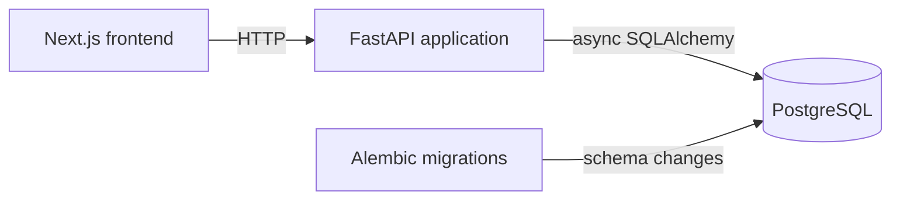

# Airport management system

A work-in-progress airport operations application with a FastAPI backend, a Next.js frontend, and PostgreSQL storage.

**Links:** Live demo: TODO · Video: TODO · Write-up: TODO

## Screenshot

TODO: Add a screenshot of the running application once the product UI is implemented.

## What it does

- Serves a FastAPI health endpoint at `GET /health`.
- Defines a `flights` database table and `Flight` SQLAlchemy model with flight identifiers, route, schedule, and status fields.
- Runs PostgreSQL locally through Docker Compose.
- Provides a Next.js frontend development shell at `http://localhost:3000`.

## Status

- [x] FastAPI application scaffold with CORS configuration.
- [x] Health endpoint returning `{"status": "ok"}`.
- [x] PostgreSQL Docker service and Alembic migration setup.
- [x] Initial flight model and migration.
- [x] Next.js frontend scaffold.
- [ ] Wire the flights router into the FastAPI application.
- [ ] Build the airport operations UI and connect it to the API.
- [ ] Implement gate allocation with Google OR-Tools.
- [ ] Add a simulator and realtime update channel.
- [ ] Deploy the application and add a public demo link.

## Why I built it

This project is a foundation for an airport management system. The current repository establishes the backend, frontend, database, and migration boundaries before the operational workflows are built.

## Architecture



The frontend is a Next.js application. The API is one FastAPI application that currently exposes the health route and contains modular backend code for future domain features. PostgreSQL is the persistent store, and Alembic applies its schema migrations. A simulator and realtime channel are planned but are not implemented in the current code.

See the component notes in [docs/architecture.md](docs/architecture.md).

## Key engineering decisions

| Decision | Record |
| --- | --- |
| Keep the backend as one modular FastAPI application | [ADR 0001](docs/adr/0001-modular-monolith.md) |
| Use Neon Postgres for deployment and local PostgreSQL in Docker | [ADR 0002](docs/adr/0002-neon-postgres.md) |
| Use Google OR-Tools for gate allocation | [ADR 0003](docs/adr/0003-or-tools-gate-allocation.md) |

## Run it locally

### Prerequisites

- Docker with Docker Compose
- Node.js and npm
- `uv`

The repository contains `docker-compose.yaml` (not `docker-compose.yml`).

### Setup and start

From a fresh clone, run these PowerShell commands one per line:

```powershell
Copy-Item .env.example apps/api/.env
Add-Content -Path apps/api/.env -Value @("JWT_ALGORITHM=HS256", "ACCESS_TOKEN_MINUTES=30", "REFRESH_TOKEN_MINUTES=10080")
docker compose up -d db
Set-Location apps/api
uv sync
uv run alembic upgrade head
uv run uvicorn app.main:app --reload --host 0.0.0.0 --port 8000
```

In a second PowerShell window, from the repository root:

```powershell
Set-Location apps/web
npm install
npm run dev
```

Open [http://localhost:3000](http://localhost:3000) for the frontend and [http://localhost:8000/health](http://localhost:8000/health) for the API health response.

The command sequence is derived from the checked-in Compose, environment, Python, and frontend configuration. It has not been verified from a fresh clone in this environment. The extra `Add-Content` command is required because the current `.env.example` does not define `JWT_ALGORITHM`, `ACCESS_TOKEN_MINUTES`, or `REFRESH_TOKEN_MINUTES`, although the API settings require them.

## Tests and results

The API declares `pytest` and `pytest-asyncio` as development dependencies, but no test files are currently present in `apps/api/tests`. The frontend package defines a `lint` script but no test script.

```powershell
Set-Location apps/api
uv run pytest
Set-Location ..\web
npm run lint
```

TODO: Run these commands in a clean environment and record the results. No test or benchmark metrics are claimed here.

## Project structure

```text
.
├── apps/
│   ├── api/                 FastAPI app, models, migrations, and solver module
│   └── web/                 Next.js frontend
├── docs/
│   ├── adr/                 Architecture decision records
│   └── architecture.md     Component and data-flow notes
├── .env.example             Local and Neon database configuration template
├── docker-compose.yaml      Local PostgreSQL and optional Redis services
└── README.md
```

## Roadmap

- Implement and register flight CRUD endpoints.
- Build the airport operations screens in the frontend.
- Implement gate allocation using the OR-Tools dependency.
- Add a simulator for operational events.
- Add a realtime channel for live updates.
- Add automated API and frontend tests.
- Deploy the API and frontend and document the live URLs.

## About the author

TODO: Add the author's name, role, and contact or profile link.
