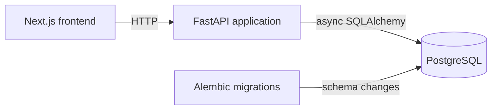

# Architecture

## Data flow

### Frontend

The frontend is a Next.js application in `apps/web`. Its current page is the generated starter page, and it runs with the `next dev` script on port 3000.

### API

The backend is a single FastAPI application in `apps/api`. It configures CORS from environment settings and currently registers the `/health` route. The repository also contains modular auth, flights, and gates code, but the flight router is not currently included by `app.main`.

### Database

PostgreSQL runs locally from the `postgis/postgis:16-3.4` Docker image in `docker-compose.yaml`. The API connects through SQLAlchemy's async engine and `asyncpg`. Alembic migrations create the current `flights` table.

### Migrations

Alembic loads the SQLAlchemy metadata from the application and applies migrations from `apps/api/migrations`. This is a schema-management component rather than a runtime request path.

There is no simulator or realtime channel implemented in the current repository, so neither appears in this diagram. They remain planned components.
